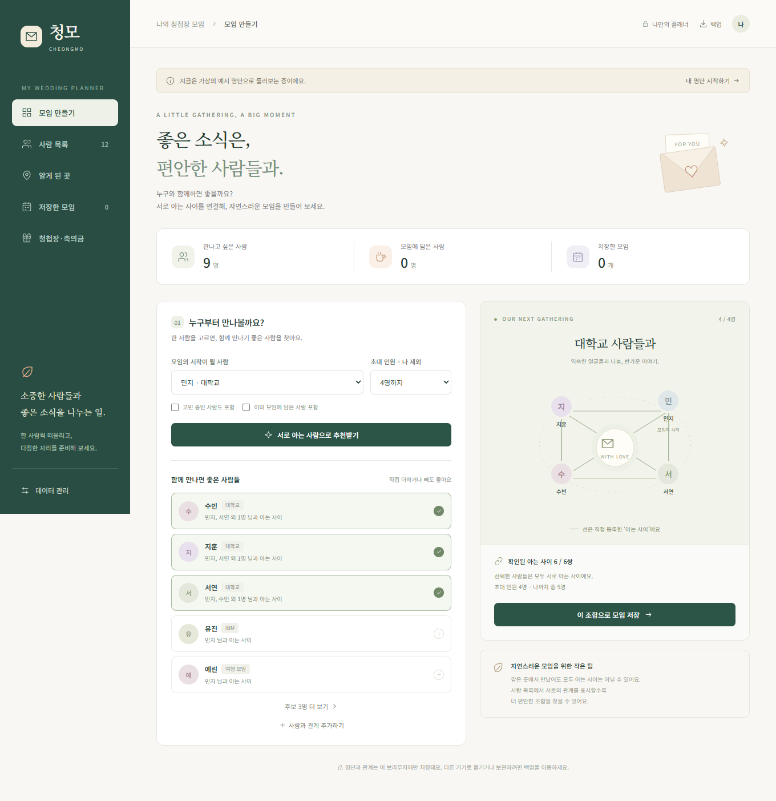

# 청모 플래너 · Cheongmo

서로 아는 사람끼리 편안하게 만날 수 있도록 청첩장 모임을 준비하는 개인용 웹 플래너입니다. 초대할 사람, 관계, 모임 일정과 축의금 기록을 한곳에서 관리합니다.



## 주요 기능

- **사람 관리**: 초대 여부, 여러 인연 그룹, 개인 메모를 저장합니다.
- **모임 추천**: 직접 등록한 ‘아는 사이’를 바탕으로 인원을 조합하고, ‘따로 만나기’ 관계를 우선 반영합니다.
- **모임 준비**: 추천 조합을 직접 수정하고 관계도, 날짜, 장소, 만남 완료 여부를 관리합니다.
- **안내문 복사**: 개인 관계 메모를 제외한 모임 안내문을 복사합니다. 메시지를 자동 전송하지 않습니다.
- **청첩장·축의금 기록**: 받은 청첩장, 내가 낸 축의금, 결혼식 날짜를 기록합니다. 미기록과 0원을 구분하며 금액은 추천에 사용하지 않습니다.
- **백업·복원**: JSON 파일로 백업하고, 복원 전에 데이터 형식과 관계 참조를 검증합니다.

## 바로 실행하기

### 설치 없이 열기

저장소를 내려받은 뒤 [청모.html](청모.html)을 브라우저로 열면 됩니다. 이 파일에는 스타일과 스크립트가 포함되어 있어 인터넷 연결 없이 사용할 수 있습니다.

### 로컬 웹 서버

Node.js 20 이상에서 별도 패키지 설치 없이 실행합니다.

```sh
cd cheongmo
npm start
```

브라우저에서 <http://127.0.0.1:4173>을 엽니다.

```sh
npm test                     # 추천·관계·백업 로직 테스트
node build-standalone.mjs     # 상위 폴더의 청모.html 다시 생성
node check-standalone.mjs     # 단일 파일의 문법·오프라인 의존성 확인
```

## 구현과 데이터 저장

| 구분 | 구성 |
| --- | --- |
| 화면 | HTML, CSS, JavaScript ES Modules |
| 추천 | 명시적으로 입력한 관계를 사용하는 규칙 기반 조합 |
| 저장 | 브라우저 localStorage |
| 실행·검증 | Node.js 기본 HTTP 서버, `node:test` |

```text
cheongmo/dist/       화면·스타일·앱·추천/검증 로직
cheongmo/tests/      추천 및 백업 호환성 테스트
cheongmo/preview.mjs 로컬 서버
청모.html           오프라인용 단일 HTML
docs/preview.png    가상 데이터로 만든 화면 예시
```

현재 정적 파일을 직접 편집하는 구조이며, `cheongmo/dist/`가 실행 소스입니다. 이름과 달리 이 디렉터리는 저장소에 포함합니다.

## 사용 범위와 제한

- 서버 계정이나 DB 없이 현재 브라우저에 저장합니다. 기기 간 자동 동기화와 공동 편집은 지원하지 않습니다.
- 저장되는 명단·관계·축의금은 암호화된 보관함이 아닙니다. 공용 기기 사용과 브라우저 데이터 삭제에 주의하고 JSON 백업을 보관하세요.
- 로컬 HTML 파일과 웹 주소의 저장 영역은 다릅니다. 파일 위치나 기기를 바꾸기 전에 백업 후 복원하세요.
- 저장소의 예시 명단과 화면은 가상 데이터입니다. 개인 명단, 백업 파일, 로컬 배포 설정은 공개하지 않습니다.
- 웹 버전은 Google Fonts를 요청할 수 있습니다. 오프라인 단일 파일에서는 외부 폰트를 제거하고 시스템 폰트를 사용합니다.

개인 프로젝트로 개발 중이며, 추천은 사람들의 실제 관계를 자동으로 추정하지 않습니다. [상세 실행 안내](cheongmo/README.md)
